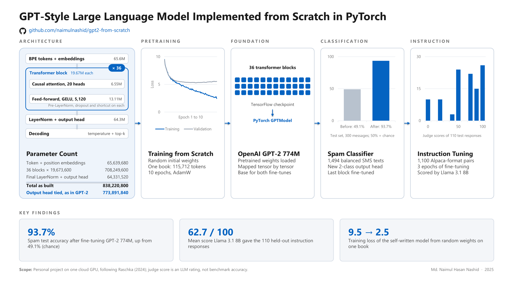
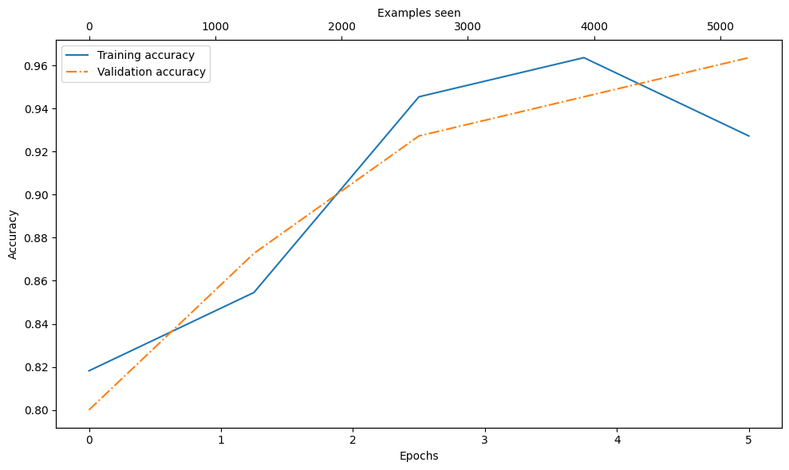
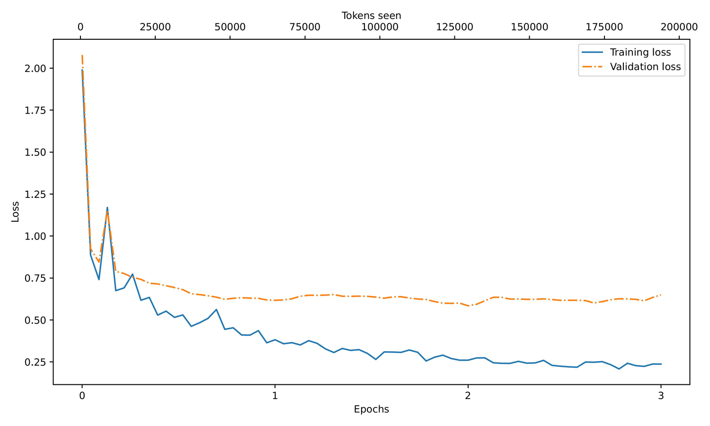
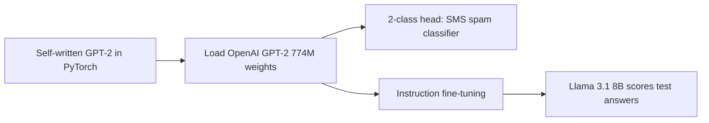

# GPT-2 (774M) Implemented from Scratch in PyTorch

A GPT-2 language model written layer by layer in PyTorch, then loaded with OpenAI's pretrained GPT-2 774M weights and fine-tuned twice: as an SMS spam classifier and as an instruction-following assistant. Self-study project, January 2025, following Sebastian Raschka's *Build a Large Language Model (From Scratch)* (Manning, 2024).

This repository is a project showcase, not a maintained library.



## Demo

| Spam classifier, accuracy by epoch | Instruction fine-tuning, loss |
|---|---|
|  |  |

All plots come from the notebook's own saved outputs.

## Features

The notebook [`gpt2_from_scratch.ipynb`](gpt2_from_scratch.ipynb) runs in four stages:

1. **Architecture, written from scratch.** Causal multi-head attention, feed-forward blocks with GELU, layer normalization, shortcut connections, token and position embeddings, BPE tokenization (`tiktoken`), a training loop, and text generation with temperature scaling and top-k sampling. As a check of the code, a small run trains it from random weights on one book.
2. **Pretrained weights.** Loads OpenAI's GPT-2 774M checkpoint into the self-written model, mapping each tensor to its layer.
3. **Classification fine-tuning.** Replaces the 50,257-way output layer with a 2-class head and trains the last transformer block and final LayerNorm on SMS spam.
4. **Instruction fine-tuning.** Trains on 1,100 instruction and response pairs (Alpaca prompt format), then has Llama 3.1 8B, served locally by Ollama, score each answer on the 110 held-out test instructions from 0 to 100.

### Results

| Stage | Result |
|---|---|
| 1. Training from random weights (one book, 10 epochs) | Training loss 9.5 to 2.5; validation loss levels off near 5.5. The model overfits one book, as expected: this run only shows the training code works. |
| 3. Spam classification (1,494 messages, balanced; 5 epochs) | Test accuracy 49.1% before fine-tuning, 93.7% after |
| 4. Instruction fine-tuning (935 train, 55 validation, 110 test; 3 epochs) | Mean score 62.7 out of 100 from the Llama 3.1 8B judge |

The judge score is one model's opinion of another model's answers, not a standard benchmark.

## Installation and getting started

Prerequisites: Python 3.11 and an NVIDIA GPU. The original run used one NVIDIA L40S (48 GB) on [Lightning AI](https://lightning.ai/); about 47 GB of its GPU memory was in use during one of the 774M runs ([screenshot](results/gpu_memory_l40s.png)).

```bash
git clone https://github.com/naimulnashid/gpt2-from-scratch.git
cd gpt2-from-scratch
pip install -r requirements.txt
jupyter notebook gpt2_from_scratch.ipynb
```

No releases or packages are published: the notebook is the project.

## Configuration

The notebook was run on Lightning AI, so two paths point at that workspace. Before running elsewhere, change them to local files:

- Stage 1 `file_path`: any plain-text book (see [`data/README.md`](data/README.md)).
- Stage 3 `zip_path` and `extracted_path`: where to save the SMS Spam Collection.

Stage 4's evaluation needs [Ollama](https://ollama.com/) running with `ollama pull llama3.1:8b`.

## Usage

Run the notebook top to bottom. Each stage saves its weights (`*.pth`) and plots; Stage 4 also writes the model's answers to the test instructions, kept here as [`results/instruction_test_responses.json`](results/instruction_test_responses.json).

## Tech stack and architecture

PyTorch for the model and training, `tiktoken` for GPT-2's BPE tokenizer, TensorFlow only to read OpenAI's original checkpoint files, Matplotlib for plots, and Ollama's REST API for the judge model.



## Security and privacy

No credentials are used. All data is public and is downloaded by the notebook, not stored here.

## Development

The project is complete and not under development. [`results/`](results/) holds the saved plots and outputs; [`data/README.md`](data/README.md) lists every dataset and where it comes from.

## Credits, license and support

- The notebook follows Sebastian Raschka, *Build a Large Language Model (From Scratch)*, Manning, 2024, and its code repository [rasbt/LLMs-from-scratch](https://github.com/rasbt/LLMs-from-scratch). [`gpt_download3.py`](gpt_download3.py) is taken unchanged from that repository under the Apache License 2.0 ([copy](third_party_licenses/Apache-2.0.txt)).
- GPT-2 weights: OpenAI. SMS Spam Collection: UCI Machine Learning Repository. Instruction data: the book's repository.
- No license is granted for the rest of this repository: it is shared to show the work, not for reuse.
- This is a personal showcase, so issues and pull requests are not monitored.
